  <picture>
    <source media="(prefers-color-scheme: dark)" srcset="./dark.svg" />
    <source media="(prefers-color-scheme: light)" srcset="./light.svg" />
    
  </picture>

<h1 align="center">Hi, I'm Bayad.</h1>

Software Engineering Student

---

## About

The future
